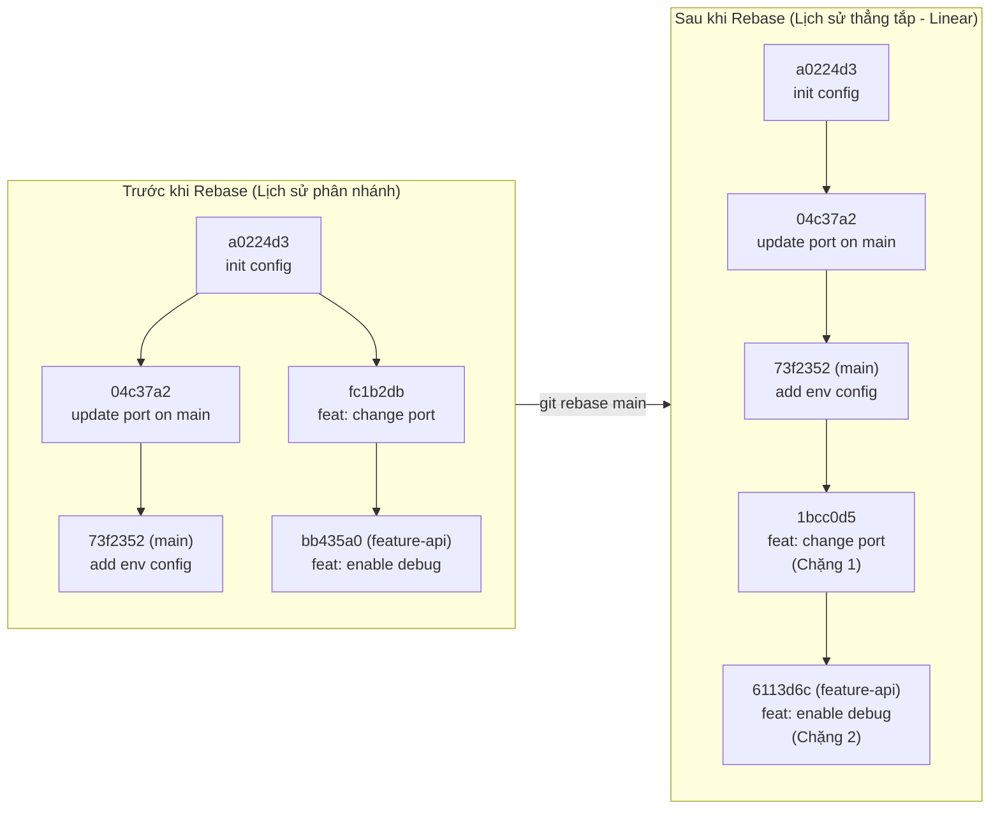
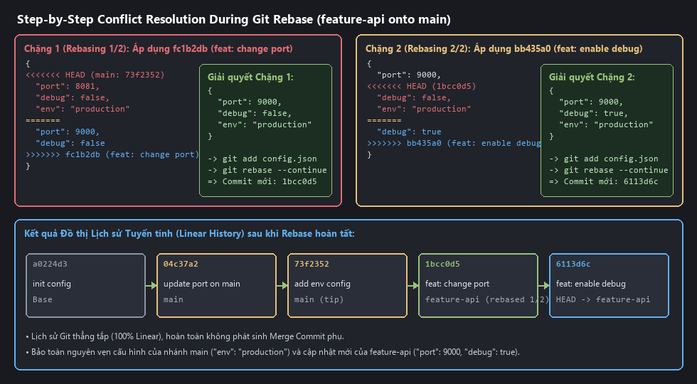
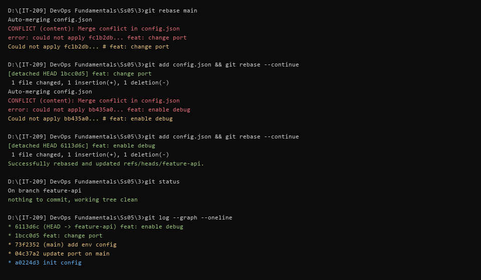

# Báo Cáo Bài Tập 3: Xử Lý Xung Đột Phức Tạp Trong Quá Trình Rebase

- **Môn học**: DevOps Fundamentals (IT-209)
- **Session**: 05 - Git Advanced & Recovery
- **Bài tập**: Bài 3 - Xử lý xung đột phức tạp trong quá trình Rebase
- **Đường dẫn nộp bài trên GitHub**: `homework/session_05/ex3/`
- **Học viên**: HoQuocKhai
- **Email**: khaiho6040@gmail.com

---

## 1. Mục tiêu bài thực hành
1. **Phân biệt giải quyết xung đột giữa Merge và Rebase**: Hiểu rõ bản chất khi `git merge` (trộn 1 lần tại điểm giao cuối) so với khi `git rebase` (áp dụng lại từng commit một - *replay commit-by-commit* lên đầu nhánh đích).
2. **Thực hành giải quyết xung đột từng chặng (Step-by-step Conflict Resolution)**: Xử lý thủ công các xung đột phát sinh ở từng commit trong tiến trình `git rebase main` bằng `git add` và `git rebase --continue`.
3. **Đạt được lịch sử tuyến tính (Linear History)**: Đưa các commit của nhánh `feature-api` nối tiếp thẳng hàng ngay phía trên các commit mới nhất của nhánh `main` mà không tạo ra bất kỳ merge commit phụ nào.

---

## 2. Cơ sở lý thuyết: Sự khác biệt khi giải quyết Conflict trong Merge vs Rebase

| Tiêu chí | Giải quyết Conflict khi `git merge` | Giải quyết Conflict khi `git rebase` |
| :--- | :--- | :--- |
| **Cơ chế hoạt động** | So sánh trạng thái cuối cùng của 2 nhánh với ancestor chung và gộp **1 lần duy nhất**. | Tách từng commit của nhánh hiện tại (`feature-api`) và áp dụng lần lượt từng commit lên đỉnh của nhánh đích (`main`). |
| **Số lần xử lý Conflict** | Tối đa **1 lần** trong lúc tạo Merge Commit. | Có thể xảy ra **ở từng chặng commit** (`Rebasing (1/N)`, `Rebasing (2/N)`...). |
| **Ý nghĩa con trỏ `HEAD` trong vùng `<<<<<<< HEAD`** | `HEAD` đại diện cho **nhánh hiện tại** đang đứng để gọi lệnh merge. | **Ngược lại**: `HEAD` đại diện cho **nhánh đích (`main`)** cộng với các commit đã rebase xong trước đó; còn phần dưới `=======` là **commit đang được replay** của nhánh tính năng. |
| **Lệnh hoàn tất sau khi sửa file** | `git add <file>` $\rightarrow$ `git commit` | `git add <file>` $\rightarrow$ `git rebase --continue` (tuyệt đối không chạy `git commit` thủ công). |
| **Hình thái đồ thị lịch sử (`git log --graph`)** | Tạo nhánh rẽ và nút thắt Merge Commit (`|\` và `|/`). | **Thẳng tắp 100%** (`*` nối tiếp nhau trên một đường thẳng). |



---

## 3. Quá trình thực hiện và xử lý xung đột từng chặng

### Bước 1: Tạo commit gốc trên nhánh `main`
Khởi tạo kho chứa trên nhánh `main` và tạo tệp cấu hình [config.json](file:///d:/%5BIT-209%5D%20DevOps%20Fundamentals/Ss05/3/config.json) ban đầu:
```json
{
  "port": 8080,
  "debug": false
}
```
```bash
git init -b main
git config --local user.name "HoQuocKhai"
git config --local user.email "khaiho6040@gmail.com"
git add config.json && git commit -m "init config"
```
**Kết quả:** `[main (root-commit) a0224d3] init config`

---

### Bước 2: Phát triển 2 commit trên nhánh `feature-api`
Tạo và chuyển sang nhánh `feature-api`:
```bash
git checkout -b feature-api
```

1. **Commit 1 trên `feature-api` (`feat: change port`)**: Đổi `"port": 9000` trong [config.json](file:///d:/%5BIT-209%5D%20DevOps%20Fundamentals/Ss05/3/config.json):
   ```json
   {
     "port": 9000,
     "debug": false
   }
   ```
   ```bash
   git add config.json && git commit -m "feat: change port"
   ```
   **Kết quả:** `[feature-api fc1b2db] feat: change port`

2. **Commit 2 trên `feature-api` (`feat: enable debug`)**: Đổi `"debug": true` trong [config.json](file:///d:/%5BIT-209%5D%20DevOps%20Fundamentals/Ss05/3/config.json):
   ```json
   {
     "port": 9000,
     "debug": true
   }
   ```
   ```bash
   git add config.json && git commit -m "feat: enable debug"
   ```
   **Kết quả:** `[feature-api bb435a0] feat: enable debug`

---

### Bước 3: Bổ sung 2 commit mới trên nhánh `main`
Chuyển về nhánh `main`:
```bash
git checkout main
```

1. **Commit 1 trên `main` (`update port on main`)**: Sửa `"port": 8081`:
   ```json
   {
     "port": 8081,
     "debug": false
   }
   ```
   ```bash
   git add config.json && git commit -m "update port on main"
   ```
   **Kết quả:** `[main 04c37a2] update port on main`

2. **Commit 2 trên `main` (`add env config`)**: Bổ sung cấu hình `"env": "production"`:
   ```json
   {
     "port": 8081,
     "debug": false,
     "env": "production"
   }
   ```
   ```bash
   git add config.json && git commit -m "add env config"
   ```
   **Kết quả:** `[main 73f2352] add env config`

Kiểm tra đồ thị phân nhánh trước khi Rebase (`git log --graph --oneline --all`):
```text
* 73f2352 (main) add env config
* 04c37a2 update port on main
| * bb435a0 (feature-api) feat: enable debug
| * fc1b2db feat: change port
|/
* a0224d3 init config
```

---

### Bước 4: Thực thi `git rebase main` và giải quyết Conflict Chặng 1 (`Rebasing 1/2`)
Chuyển về nhánh `feature-api` và bắt đầu rebase lên `main`:
```bash
git checkout feature-api
git rebase main
```
**Thông báo phát sinh Conflict Chặng 1:**
```text
Rebasing (1/2)
Auto-merging config.json
CONFLICT (content): Merge conflict in config.json
error: could not apply fc1b2db... feat: change port
Could not apply fc1b2db... # feat: change port
```

#### Nội dung `config.json` khi xảy ra Conflict Chặng 1:
```json
{
<<<<<<< HEAD
  "port": 8081,
  "debug": false,
  "env": "production"
=======
  "port": 9000,
  "debug": false
>>>>>>> fc1b2db (feat: change port)
}
```
*Phân tích Chặng 1*:
- `<<<<<<< HEAD` là trạng thái mới nhất của nhánh `main` (`73f2352`: `"port": 8081`, có thêm `"env": "production"`).
- `>>>>>>> fc1b2db (feat: change port)` là commit thứ nhất của `feature-api` muốn đổi `"port"` sang `9000`.

#### Cách giải quyết Chặng 1:
Cập nhật `"port": 9000` theo yêu cầu của commit `fc1b2db`, đồng thời **giữ nguyên `"env": "production"`** của nhánh `main` để không làm mất cấu hình trên nhánh chính:
```json
{
  "port": 9000,
  "debug": false,
  "env": "production"
}
```
Đánh dấu đã giải quyết và tiếp tục tiến trình rebase:
```bash
git add config.json
git rebase --continue
```

---

### Bước 5: Giải quyết Conflict Chặng 2 (`Rebasing 2/2`)
Ngay sau khi hoàn tất Chặng 1 (sinh ra commit mới `1bcc0d5 feat: change port`), Git tự động áp dụng tiếp commit thứ 2 (`bb435a0 feat: enable debug`) và phát sinh Conflict Chặng 2:
```text
[detached HEAD 1bcc0d5] feat: change port
 1 file changed, 1 insertion(+), 1 deletion(-)
Rebasing (2/2)
Auto-merging config.json
CONFLICT (content): Merge conflict in config.json
error: could not apply bb435a0... feat: enable debug
Could not apply bb435a0... # feat: enable debug
```

#### Nội dung `config.json` khi xảy ra Conflict Chặng 2:
```json
{
  "port": 9000,
<<<<<<< HEAD
  "debug": false,
  "env": "production"
=======
  "debug": true
>>>>>>> bb435a0 (feat: enable debug)
}
```
*Phân tích Chặng 2*:
- `"port": 9000` đã được giải quyết ở Chặng 1 nên không còn xung đột.
- Xung đột xảy ra ở dòng `"debug"`: `HEAD` (`1bcc0d5`) đang có `"debug": false,` kèm `"env": "production"`, trong khi commit `bb435a0` đổi `"debug"` thành `true` (không có dấu phẩy và chưa có trường `env`).

#### Cách giải quyết Chặng 2:
Cập nhật `"debug": true,` theo commit `bb435a0` và bảo toàn trường `"env": "production"` của nhánh `main`:
```json
{
  "port": 9000,
  "debug": true,
  "env": "production"
}
```
Đánh dấu đã giải quyết và hoàn tất tiến trình rebase:
```bash
git add config.json
git rebase --continue
```
**Kết quả thực tế:**
```text
[detached HEAD 6113d6c] feat: enable debug
 1 file changed, 1 insertion(+), 1 deletion(-)
Successfully rebased and updated refs/heads/feature-api.
```

---

## 4. Kết quả kiểm tra theo yêu cầu đề bài

### 4.1. Kiểm tra trạng thái sau khi Rebase (`git status`)
```bash
git status
```
**Kết quả thực tế:**
```text
On branch feature-api
nothing to commit, working tree clean
```

### 4.2. Kiểm tra lịch sử đồ thị sau khi hoàn thành (`git log --graph --oneline`)
```bash
git log --graph --oneline
```
**Kết quả thực tế:**
```text
* 6113d6c (HEAD -> feature-api) feat: enable debug
* 1bcc0d5 feat: change port
* 73f2352 (main) add env config
* 04c37a2 update port on main
* a0224d3 init config
```

### 4.3. Nội dung tệp `config.json` hoàn chỉnh sau cùng
```json
{
  "port": 9000,
  "debug": true,
  "env": "production"
}
```
-> **Đánh giá**:
- Lịch sử Git trên `git log --graph --oneline` thẳng tắp 100%, không xuất hiện bất kỳ merge commit phụ nào.
- Hai commit của `feature-api` (`1bcc0d5` và `6113d6c`) nằm nối tiếp ngay phía trên hai commit mới nhất của `main` (`04c37a2` và `73f2352`), bảo toàn đầy đủ cấu hình của cả hai nhánh.

---

## 5. Ảnh chụp màn hình minh chứng

### Minh chứng 1: Sơ đồ giải quyết xung đột từng chặng (Chặng 1 & Chặng 2) và đồ thị tuyến tính


### Minh chứng 2: Kết quả thực thi `git rebase main`, `git status` và `git log --graph --oneline` trên Terminal


---

## 6. Bài học kinh nghiệm
1. **Không dùng `git commit` trong khi đang Rebase**: Khi dừng lại ở trạng thái conflict trong quá trình rebase, sau khi sửa file và chạy `git add <file>`, chỉ cần chạy `git rebase --continue` để Git tự đóng gói commit đang dang dở.
2. **Cứu hộ khẩn cấp với `git rebase --abort`**: Nếu trong quá trình giải quyết conflict nhiều chặng mà phát hiện gộp sai logic phức tạp, có thể chạy ngay `git rebase --abort` để hủy bỏ tiến trình rebase và khôi phục nhánh về nguyên trạng ban đầu trước khi rebase.
